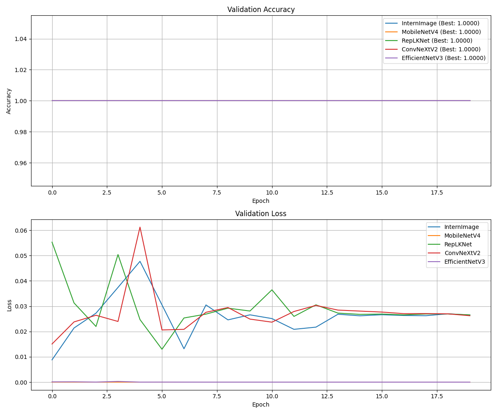
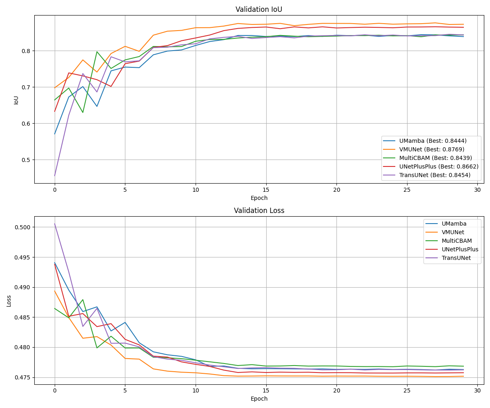

# Oil Spill Detection Project Report

## Classification Models Performance

|    | Model          |   Best Validation Accuracy |
|---:|:---------------|---------------------------:|
|  0 | InternImage    |                          1 |
|  1 | MobileNetV4    |                          1 |
|  2 | RepLKNet       |                          1 |
|  3 | ConvNeXtV2     |                          1 |
|  4 | EfficientNetV3 |                          1 |

## Segmentation Models Performance

|    | Model        |   Best Validation IoU |
|---:|:-------------|----------------------:|
|  1 | VMUNet       |              0.876897 |
|  3 | UNetPlusPlus |              0.866219 |
|  4 | TransUNet    |              0.84544  |
|  0 | UMamba       |              0.844374 |
|  2 | MultiCBAM    |              0.843866 |

## Performance Visualizations

## Conclusions

The best performing classification model was **InternImage** with a validation accuracy of 1.0000.

The best performing segmentation model was **VMUNet** with a validation IoU of 0.8769.

